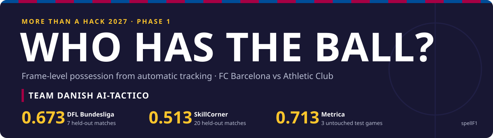
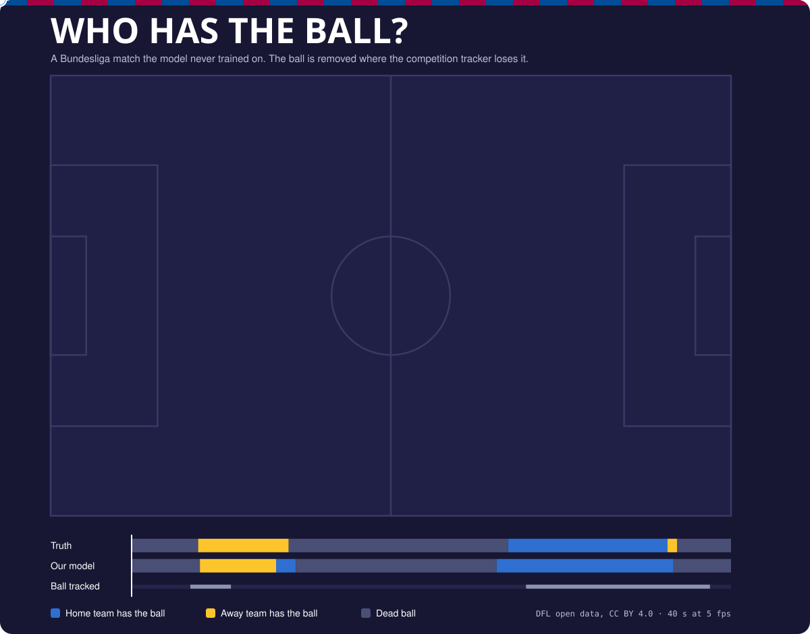
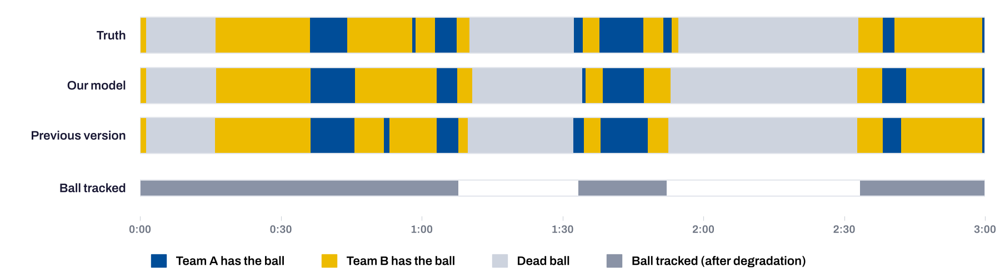

<p align="center"></p>

<p align="center">
  
  
  
  
</p>

# Danish AI-Tactico

Our entry for More than a Hack 2027, Phase 1: label every frame of FC Barcelona vs Athletic Club
as Barça (`H`), Athletic (`A`), dead ball (`D`) or no call (`X`), from automatic tracking where the
ball is missing on four frames in ten.



<sub>A Bundesliga match from the DFL open data that the model never trained on, with the ball
removed the way the competition tracker loses it. The clip is a typical one, not the best: the model
agrees with the truth on 93 % of its frames and on 93 % of the whole match. It misses the last,
half-second away touch and adds a short home spell that was not there. Regenerate it with `tools/make_readme_anim.py`. No competition data is
shown anywhere in this repository.</sub>

The repository is built on Metrica Sports'
[challenge repository](https://github.com/metrica-sports/more-than-a-hack-2027). Their code is
unchanged (`games.py`, `evaluation/`, `starter/`), and their docs are synced with the current
official version (their README is now `README_metrica.md`). Our write-up is
[`Danish_AI-Tactico.md`](Danish_AI-Tactico.md).


## How it works

Every frame becomes 85 numbers: distances from the ball to each team, how far each team is pushed
up and how spread out it is, how fast the players move, how long the ball has been missing, and
when each team last touched the ball and next will. A touch is a sharp turn or change of speed of
the ball with one team's player closest and within 1.5&nbsp;m.
Both teams get the same block of features, and the models see both orders, so they cannot learn
anything about which side is the home team.

Two models turn those numbers into probabilities. A gradient-boosted classifier looks at a few
seconds around the frame. Three bidirectional GRUs, trained from different seeds, read the whole
half and can carry what happened before a long gap in the ball tracking. We average them with a
weight of 0.8 on the GRUs. A Viterbi decoder then charges a cost for every change of label, which
turns the per-frame guesses into whole possessions. During training, frames inside short
possessions count up to three times as much, because spellF1 gives a two-second possession the same
weight as a forty-second one.

Nothing is fitted to the competition match, its ground truth or its video. All training and tuning
uses external data:

| Data | Licence | Use |
|---|---|---|
| [DFL / Sportec open data](https://doi.org/10.6084/m9.figshare.28196177), 7 Bundesliga matches | CC BY 4.0 | training, degraded to look like the competition tracking |
| [SkillCorner open data](https://github.com/SkillCorner/opendata), 20 A-League matches | MIT | training; real automatic tracking with real gaps |
| SkillCorner's 2020 release, 9 European matches (same repository, git history) | MIT | training only; labels only where a player has the ball |
| [Metrica sample data](https://github.com/metrica-sports/sample-data), 3 matches | public | test set only |

The DFL tracking is clean, so we remove the ball where the competition tracker loses it. We measured
that with two scripts that print summary numbers only: the ball is missing on 41&nbsp;% of frames, and
mostly when the players walk (80&nbsp;% below 1&nbsp;m/s, 11&nbsp;% above 2&nbsp;m/s).

## Results on external matches

spellF1 on matches the models were not trained on: five-fold cross-validation over DFL and
SkillCorner, and the three Metrica games as a final test.

| Held out | Classifier only | Without touch features | Submitted (classifier + 3 GRUs) |
|---|---|---|---|
| DFL, 7 matches | 0.624 | 0.633 | **0.673** |
| SkillCorner, 20 matches | 0.459 | **0.516** | 0.513 |
| Metrica, 3 matches (test only) | – | 0.654 | **0.713** |

The touch features helped on all seven DFL matches and all three Metrica games, and did nothing on
SkillCorner, whose broadcast ball jumps too much for a turn of the ball to mean anything. The
competition ball is smooth, like DFL's. A classifier trained only on clean DFL data scored 0.306 on
SkillCorner, which is why SkillCorner is in the training set at all. The blend weight and the
decoding costs (4 per change of team, 12 in or out of a dead ball) were picked on these folds with
`tools/blend_cv.py`, with a criterion fixed before we looked at the numbers.

These scores are on other matches, under other providers' definitions of possession, so they
cannot be compared with the competition board or its published baseline (spellF1 0.2433 on the
full match). The SkillCorner labels also come from SkillCorner's own algorithm, so that row measures
how closely we reproduce it on automatic tracking.



<sub>A window chosen because its agreement matches the match average, not because the new model
wins it: here the version without touch features is one point better.</sub>

## Reproduce the submitted file

The trained models are in `models/`, so you only need the competition data. We used Python 3.11,
and `requirements-ml.txt` pins the library versions that produced the file.

```bash
pip install -r requirements.txt -r requirements-ml.txt
export MTAH_DATA_DIR=/path/to/data            # Windows: $env:MTAH_DATA_DIR = "C:\mtah-data"
python run.py --model models/possession.pkl --seq models/sequence.pt --seq-weight 0.8 --switch-cost 4 --dead-cost 12
python evaluation/validate_submission.py evaluation/results/Danish_AI-Tactico.csv
```

This writes `evaluation/results/Danish_AI-Tactico.csv`. Two runs give the same file byte for byte.

## Retrain from the external data

```bash
git clone --depth 1 https://github.com/metrica-sports/sample-data.git C:/mtah-ext/sample-data
git clone --depth 1 https://github.com/SkillCorner/opendata.git C:/mtah-ext/skillcorner
python tools/external/dfl_open.py --out C:/mtah-ext/dfl
python tools/external/skillcorner_open.py --src C:/mtah-ext/skillcorner/data/matches --out C:/mtah-ext/sc
git clone --filter=blob:none --no-checkout https://github.com/SkillCorner/opendata.git C:/mtah-ext/sc-old-repo
python tools/external/skillcorner_old.py --repo C:/mtah-ext/sc-old-repo --out C:/mtah-ext/sc-old

python tools/train_ml.py --dfl-dir C:/mtah-ext/dfl --sc-dir C:/mtah-ext/sc --extra-dir C:/mtah-ext/sc-old --save models/possession.pkl --switch-cost 8 --dead-cost 16 --spell-balance 1.0
python tools/train_seq.py --dfl-dir C:/mtah-ext/dfl --sc-dir C:/mtah-ext/sc --extra-dir C:/mtah-ext/sc-old --epochs 6 --seeds 3 --save models/sequence.pt --spell-balance 1.0
```

The cross-validation behind the numbers above:

```bash
python tools/cv_multi.py --dfl-dir C:/mtah-ext/dfl --sc-dir C:/mtah-ext/sc --sample-dir C:/mtah-ext/sample-data
python tools/train_seq.py --dfl-dir C:/mtah-ext/dfl --sc-dir C:/mtah-ext/sc --extra-dir C:/mtah-ext/sc-old --cv --seeds 3 --spell-balance 1.0 --dump C:/mtah-ext/dump
python tools/blend_cv.py C:/mtah-ext/dump
python tools/metrica_test.py --dfl-dir C:/mtah-ext/dfl --sc-dir C:/mtah-ext/sc --extra-dir C:/mtah-ext/sc-old --sample-dir C:/mtah-ext/sample-data
```

Retraining on another machine or library version can give slightly different models. The
committed ones produced the submission.

## Where things are

| Path | What |
|---|---|
| `run.py` | builds the submission file |
| `tactico/ml.py` | features, classifier wrapper, Viterbi decoder |
| `tactico/seq.py` | the GRU |
| `tools/train_ml.py`, `tools/train_seq.py` | training and cross-validation |
| `tools/blend_cv.py` | picks the blend weight and decoding costs |
| `tools/metrica_test.py` | trains on all external matches and scores the three Metrica games |
| `tools/external/` | download and convert DFL, SkillCorner and Metrica data |
| `tools/noise_match.py`, `tools/gap_profile.py` | measure the competition tracking (summary numbers only) |
| `models/` | the trained models used for the submission |
| `tools/error_report.py`, `tools/goal_debug.py`, `tools/inspect_frames.py` | from the rule-system stage; not used by the submitted model |

The earlier rule system (nearest player with hysteresis plus dead-ball rules) still runs with
`python run.py` without `--model`. We kept it as a baseline.

## Data

The match data is not in this repository: `data/` and `cache/` are gitignored. External data is
downloaded by the scripts above and is not committed either.

## Data credits

- Bassek, M., Rein, R., Weber, H. and Memmert, D. (2025). An integrated dataset of spatiotemporal
  and event data in elite soccer. *Scientific Data*. Dataset: doi:10.6084/m9.figshare.28196177,
  CC BY 4.0.
- SkillCorner open data, github.com/SkillCorner/opendata, MIT licence. Data by SkillCorner.
- Metrica Sports sample data, github.com/metrica-sports/sample-data.
- Competition data and scorer: Metrica Sports and FC Barcelona, More than a Hack 2027.
- Typefaces Archivo (Omnibus-Type) and Big Shoulders Display (Patric King), SIL Open Font Licence,
  embedded in the SVG figures under `docs/`.

## Team

<table>
<tr>
<td align="center" valign="top" width="20%"><br><b>Aryan Abdel Rahman</b><br><sub><b>Team lead</b></sub><br><sub>MSc Data Science, University of Southern Denmark</sub><br><a href="https://www.linkedin.com/in/aryan-abdel-rahman"></a></td>
<td align="center" valign="top" width="20%"><br><b>Allan Abdel Rahman</b><br><sub>Global Management and Manufacturing, University of Southern Denmark</sub><br><a href="https://www.linkedin.com/in/allan-abdel-rahman"></a></td>
<td align="center" valign="top" width="20%"><br><b>Ibraahim Dahir Xanaf</b><br><sub>MSc Data Science, University of Southern Denmark</sub><br><a href="https://www.linkedin.com/in/ibrahim-dahir-hanaf"></a></td>
<td align="center" valign="top" width="20%"><br><b>William Luu</b><br><sub>BSc Health Data, Technical University of Denmark</sub><br><a href="https://www.linkedin.com/in/william-luu"></a></td>
<td align="center" valign="top" width="20%"><br><b>Kiyan Rohanimanesh</b><br><sub>PBA Cybersecurity, UCL University College, Odense</sub><br><a href="https://www.linkedin.com/in/kiyan-rohanimanesh"></a></td>
</tr>
</table>
