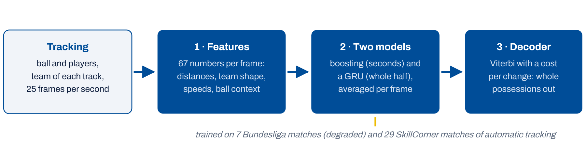

# Danish AI-Tactico

Our entry for More than a Hack 2027, Phase 1: label every frame of FC Barcelona vs Athletic Club
as Barça (`H`), Athletic (`A`), dead ball (`D`) or no call (`X`), from automatic tracking where the
ball is missing on four frames in ten.

The repository is built on Metrica Sports'
[challenge repository](https://github.com/metrica-sports/more-than-a-hack-2027). Their files are
unchanged (`games.py`, `evaluation/`, `starter/` and the docs; their README is now
`README_metrica.md`). Our write-up is [`Danish_AI-Tactico.md`](Danish_AI-Tactico.md).



## How it works

Every frame becomes 67 numbers: distances from the ball to each team, how far each team is pushed
up and how spread out it is, how fast the players move, and how long the ball has been missing.
Both teams get the same block of features, and the models see both orders, so they cannot learn
anything about which side is the home team.

Two models turn those numbers into probabilities. A gradient-boosted classifier looks at a few
seconds around the frame. Three bidirectional GRUs, trained from different seeds, read the whole
half and can carry what happened before a long gap in the ball tracking. We average them with a
weight of 0.8 on the GRUs. A Viterbi decoder then charges a cost for every change of label, which
turns the per-frame guesses into whole possessions.

Nothing is fitted to the competition match, its ground truth or its video. All training and tuning
uses external data:

| Data | Licence | Use |
|---|---|---|
| [DFL / Sportec open data](https://doi.org/10.6084/m9.figshare.28196177), 7 Bundesliga matches | CC BY 4.0 | training, degraded to look like the competition tracking |
| [SkillCorner open data](https://github.com/SkillCorner/opendata), 20 A-League matches | MIT | training; real automatic tracking with real gaps |
| SkillCorner's 2020 release, 9 European matches (same repository, git history) | MIT | training only; labels only where a player has the ball |
| [Metrica sample data](https://github.com/metrica-sports/sample-data), 3 matches | public | test set only |

The DFL tracking is clean, so we remove the ball where the competition tracker loses it. We measured
that with two scripts that print summary numbers only: the ball is missing on 41 % of frames, and
mostly when the players walk (80 % below 1 m/s, 11 % above 2 m/s).

## Results on external matches

spellF1 on matches the models were not trained on, five-fold cross-validation:

| Held out | Classifier, DFL only | Classifier, DFL + SkillCorner | Submitted (classifier + 3 GRUs) |
|---|---|---|---|
| DFL, 7 matches | 0.565 | 0.521 | **0.572** |
| SkillCorner, 20 matches | 0.306 | 0.468 | **0.499** |

The first column shows why we added SkillCorner: a model trained only on clean data falls apart on
real automatic tracking. The blend weight and the decoding costs (4 per change of team, 12 in or
out of a dead ball) were picked on these folds with `tools/blend_cv.py`.


## Reproduce the submitted file

The trained models are in `models/`, so you only need the competition data. We used Python 3.11,
and `requirements-ml.txt` pins the library versions that produced the file.

```bash
pip install -r requirements.txt -r requirements-ml.txt
export MTAH_DATA_DIR=/path/to/data            # Windows: $env:MTAH_DATA_DIR = "C:\mtah-data"
python run.py --model models/possession.pkl --seq models/sequence.pt --seq-weight 0.8 --switch-cost 4 --dead-cost 12
python evaluation/validate_submission.py evaluation/results/Danish_AI-Tactico.csv
```

This writes `evaluation/results/Danish_AI-Tactico.csv`. Two runs give the same file byte for byte.

## Retrain from the external data

```bash
git clone --depth 1 https://github.com/metrica-sports/sample-data.git C:/mtah-ext/sample-data
git clone --depth 1 https://github.com/SkillCorner/opendata.git C:/mtah-ext/skillcorner
python tools/external/dfl_open.py --out C:/mtah-ext/dfl
python tools/external/skillcorner_open.py --src C:/mtah-ext/skillcorner/data/matches --out C:/mtah-ext/sc
git clone --filter=blob:none --no-checkout https://github.com/SkillCorner/opendata.git C:/mtah-ext/sc-old-repo
python tools/external/skillcorner_old.py --repo C:/mtah-ext/sc-old-repo --out C:/mtah-ext/sc-old

python tools/train_ml.py --dfl-dir C:/mtah-ext/dfl --sc-dir C:/mtah-ext/sc --extra-dir C:/mtah-ext/sc-old --save models/possession.pkl --switch-cost 8 --dead-cost 16
python tools/train_seq.py --dfl-dir C:/mtah-ext/dfl --sc-dir C:/mtah-ext/sc --extra-dir C:/mtah-ext/sc-old --epochs 6 --seeds 3 --save models/sequence.pt
```

The cross-validation behind the numbers above:

```bash
python tools/cv_multi.py --dfl-dir C:/mtah-ext/dfl --sc-dir C:/mtah-ext/sc --sample-dir C:/mtah-ext/sample-data
python tools/train_seq.py --dfl-dir C:/mtah-ext/dfl --sc-dir C:/mtah-ext/sc --extra-dir C:/mtah-ext/sc-old --cv --seeds 3 --dump C:/mtah-ext/dump
python tools/blend_cv.py C:/mtah-ext/dump
```

Retraining on another machine or library version can give slightly different models. The
committed ones produced the submission.

## Where things are

| Path | What |
|---|---|
| `run.py` | builds the submission file |
| `tactico/ml.py` | features, classifier wrapper, Viterbi decoder |
| `tactico/seq.py` | the GRU |
| `tools/train_ml.py`, `tools/train_seq.py` | training and cross-validation |
| `tools/blend_cv.py` | picks the blend weight and decoding costs |
| `tools/external/` | download and convert DFL, SkillCorner and Metrica data |
| `tools/noise_match.py`, `tools/gap_profile.py` | measure the competition tracking (summary numbers only) |
| `models/` | the trained models used for the submission |

The earlier rule system (nearest player with hysteresis plus dead-ball rules) still runs with
`python run.py` without `--model`. We kept it as a baseline.

## Data

The match data is not in this repository: `data/` and `cache/` are gitignored. External data is
downloaded by the scripts above and is not committed either.

## Team

Aryan Abdel Rahman (team lead), Allan Abdel Rahman, Ibraahim Dahir Xanaf, William Luu and Kiyan
Rohanimanesh. Students at the University of Southern Denmark, the Technical University of Denmark
and UCL University College, Odense.
